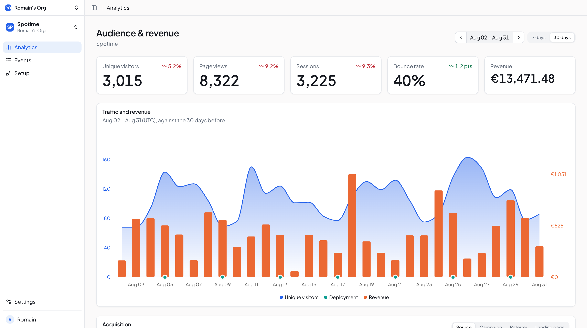
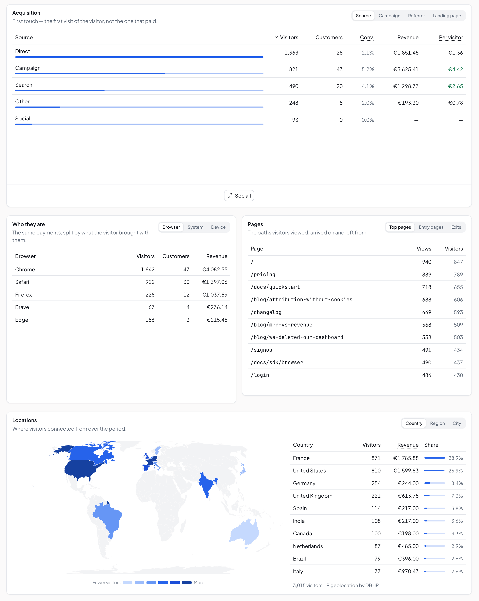
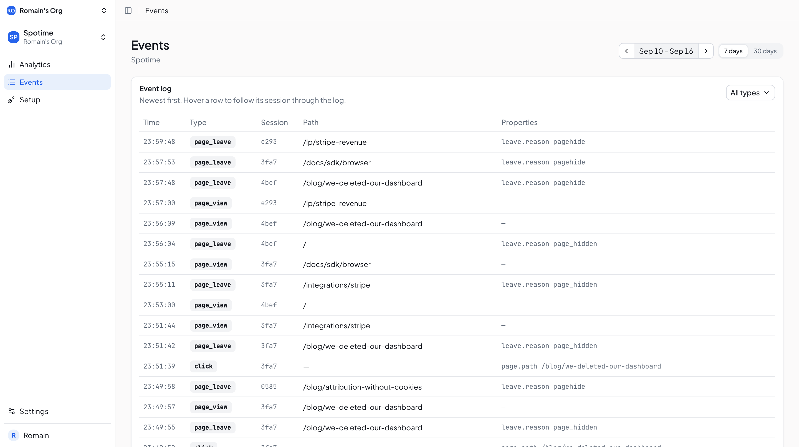
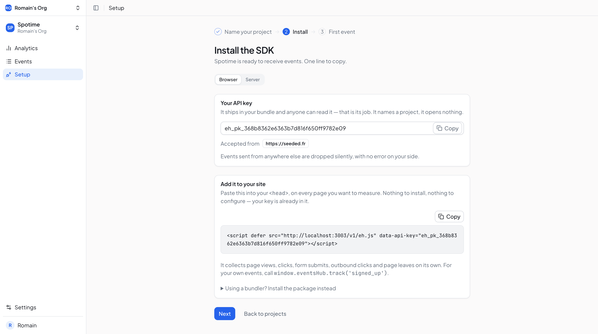

# events-hub

**An event hub that answers one question: what actually drives revenue?**

Web analytics count visitors. Stripe counts money. Nothing joins the two.
events-hub ingests events from any source — browser, backend, CI, Stripe — into
one stream, and links each payment back to the visit that produced it.



## Who it's for

- SaaS and indie teams that sell through Stripe.
- Who want attribution without a data warehouse or a tag manager.
- On sites where privacy matters: cookieless by default, GDPR-aware.

## What it answers

- Which source brings **revenue**, not just traffic?
- Which campaign, referrer or landing page converts, and what is a visitor worth?
- Which pages do buyers see?
- Did this deploy move the numbers?

## Features

**Ingestion**

- One endpoint, `POST /v1/events`, for every source. Event types are free-form.
- Two key classes: public `eh_pk_` for browsers (origin allowlist), secret `eh_sk_` for servers (hashed, shown once).
- `source` is derived from the key, never read from the payload — so it can be trusted.
- Strict validation: an unknown field is a 400, not a silently dropped value.
- Per-type `server-only` flag: events of that type forged from a browser are ignored at read time.

**Browser SDK**

- One `<script>` tag, served by the hub. No build step.
- Collects page views, clicks, form submits, outbound clicks and page leaves on its own.
- `track()` for custom events. Also usable as a typed package in bundled apps.

**Analytics**

- Visitors, sessions, page views, bounce rate, compared to the previous period.
- Acquisition by source, UTM campaign, referrer and landing page (first touch).
- Top, entry and exit pages. Browser, OS and device. Country, region and city on a world map.
- Sessions are cut at ingestion (30-minute gap) and persisted: every reader sees the same sessions.

**Revenue**

- Stripe Connect with **read-only** OAuth. No token stored.
- Webhooks become events. Payments are attributed through the visitor id placed in Stripe metadata.
- Conversion rate, revenue and revenue per visitor for every acquisition dimension.
- Traffic and revenue on one chart, with deploy markers.
- Cohorts and monthly movements (started, ended, active) in the API. Historical backfill on demand.
- Unattributed revenue is kept and counted, never hidden.

**Event explorer**

- Raw event log, newest first, cursor-paginated, filterable by type.
- Hover a row to follow its session through the log.

**Workspace**

- Organizations, members, invitations, multiple projects.
- API keys: create, revoke, edit allowed origins. Revocation is immediate.
- Guided setup that waits for the first event.

**Privacy**

- Default mode: nothing written to the device. IP and User-Agent are never stored.
- Visitor key is an HMAC that rotates daily — enough to count, not to follow.
- Consented mode: durable id in a partitioned (CHIPS) cookie, needed for cross-day attribution and LTV.
- Honors Global Privacy Control and an explicit opt-out.
- Data older than 25 months is purged daily.

<table>
  <tr>
    <td width="50%"></td>
    <td width="50%"><br><br></td>
  </tr>
</table>

## How it works

```
 Browser SDK (eh_pk_) ──┐
 Backend / CI (eh_sk_) ─┼─► POST /v1/events ─► core pipeline ─► events (Postgres)
 Stripe webhooks ───────┘   (via features/stripe)                    │
                                                                     ▼
                         dashboard ◄── features/ (analytics, revenue, explorer) ◄── EventStore
```

**Ingestion pipeline**

```
Zod (strict) → opt-out (GPC / cookie) → key → project + source
  → visitor key (HMAC) → session → GeoIP → User-Agent → EventStore → Postgres
```

**Event model**

| Field        | Set by | Meaning                                                  |
| ------------ | ------ | -------------------------------------------------------- |
| `type`       | client | free string, e.g. `page_view`, `deployment`, `signed_up` |
| `occurredAt` | client | when it happened (ISO 8601, stored in UTC, ms precision) |
| `source`     | server | `browser` or `server`, from the key class                |
| `sessionId`  | server | `null` = no visit (a deploy, a payment, a probe)         |
| `visitorKey` | server | durable consented identity only; `null` otherwise        |
| `attributes` | client | context (page path, referrer, screen…), `jsonb`          |
| `properties` | client | payload, shape depends on `type`, `jsonb`                |

The rule: **a column is a correlation axis the server derives; `jsonb` is what the client sends.** A client can never write a value the server is meant to guarantee.

No version field on events. Compatibility lives in the `/v1` URL prefix: only optional additions inside `/v1`, breaking changes go to `/v2`.

**Revenue attribution**

1. The site's backend puts `eh_visitor_id` in the Stripe Checkout Session **and** Customer metadata.
2. Stripe sends webhooks to `/v1/webhooks/stripe`.
3. `features/stripe` maps them to disjoint event types (`stripe.subscription.started`, `…renewed`, `…changed`, `stripe.payment.one_time`…).
4. Reads join each payment to the visitor's first visit.

Without consent, `eh_session_id` still attributes a purchase to that day's visit — but not renewals.

One Stripe payment fires four webhooks that all carry an amount. Revenue reads target one precise type, so the same euro is never counted four times.

## Architecture decisions worth reading

- **Core vs features, enforced by a test.** The core (`core/`, `events/`, `sessions/`, `privacy/`…) routes, stores and counts; it never knows what a type means. `architecture.spec.ts` fails the build if a core file names an event type — even in a comment.
- **One read path.** `EventStore` is the only access to the `events` table. Every read goes through one private `where()`, so a rule like `server-only` cannot be forgotten by the next module.
- **Shared contract, checked both ways.** Zod schemas in `packages/api-contract` are consumed by the dashboard; `contract.spec.ts` fails if an API response and its schema diverge in either direction.
- **Stripe data stored verbatim.** No recomputed amount that could disagree with the Stripe dashboard.
- **E2E against a real Postgres.** A shared harness keeps one listening server per suite — ad-hoc supertest ports failed once every ~66,000 requests, on a random suite.
- **Privacy documented like code.** A [privacy note](docs/privacy.md) and a [legitimate interest assessment](docs/legitimate-interest-assessment.md) describe exactly what is collected.

Design rationale lives in code comments and in [`docs/`](docs).

## Tech stack

| Area      | Tools                                                                                          |
| --------- | ---------------------------------------------------------------------------------------------- |
| API       | NestJS 11, Express 5, Drizzle ORM, PostgreSQL, Zod 4, Better Auth, Stripe SDK                  |
| Dashboard | TanStack Start, TanStack Router & Query, React 19, Tailwind CSS 4, shadcn/ui, Recharts, d3-geo |
| SDK       | TypeScript, esbuild, Vitest, jsdom — zero runtime dependencies                                 |
| Data      | DB-IP City Lite (GeoIP, MaxMind format), `@nestjs/schedule` for retention                      |
| Tooling   | pnpm workspaces, Turborepo, ESLint, Prettier, Jest, Supertest                                  |

## Repository layout

```
apps/
  api/            NestJS API — ingestion, auth, analytics, revenue   :3003
  web/            TanStack Start dashboard                            :3002
packages/
  api-contract/   Zod schemas shared by API and dashboard
  sdk/            browser SDK (script tag + package)
  eslint-config/  shared lint config
docs/             ingestion, privacy, deployment, design notes
```

## Getting started

**Requirements:** Node ≥ 24, pnpm 11, PostgreSQL.

1. Install dependencies.

   ```sh
   pnpm install
   ```

2. Create a database and a role.

   ```sql
   CREATE ROLE user_events_hub LOGIN PASSWORD '...';
   CREATE DATABASE events_hub;
   GRANT CREATE ON DATABASE events_hub TO user_events_hub;
   ```

3. Configure the API. Set `DATABASE_URL`, `VISITOR_KEY_SECRET` and `BETTER_AUTH_SECRET` (the API refuses to start without them).

   ```sh
   cp apps/api/.env.example apps/api/.env
   openssl rand -hex 32   # once per secret
   ```

4. Run the migrations, then start everything.

   ```sh
   pnpm db:migrate
   pnpm dev          # dashboard on :3002, API on :3003
   ```

5. Sign up on http://localhost:3002 and create a project.

**Optional**

- Demo data: `pnpm --filter api db:seed "<project name or id>"` fills a project with 120 days of traffic, campaigns, bots, deploys and Stripe subscriptions.
- Geolocation: download [DB-IP City Lite](https://db-ip.com/db/download/ip-to-city-lite) (`.mmdb`) and set `GEOIP_DB_PATH`.
- Stripe: set `STRIPE_SECRET_KEY`, `STRIPE_CONNECT_CLIENT_ID`, `STRIPE_WEBHOOK_SECRET`. Without them the API still runs; only the Stripe connection is disabled.

## Sending events

From a website:

```html
<script
  defer
  src="https://your-hub.example/v1/eh.js"
  data-api-key="eh_pk_…"
></script>
<script>
  window.eventsHub?.track('signed_up', { plan: 'pro' });
</script>
```

From a backend or CI:

```sh
curl -X POST https://your-hub.example/v1/events \
  -H 'Content-Type: application/json' \
  -d '{
    "apiKey": "eh_sk_…",
    "type": "deployment",
    "occurredAt": "2026-08-30T12:41:04Z",
    "properties": { "release.tag": "v1.5.0" }
  }'
```

Full guide: [`docs/ingestion.md`](docs/ingestion.md).

## API overview

All routes are prefixed with `/v1`. Project routes require a session and project membership.

| Route                                                                             | Purpose                                      |
| --------------------------------------------------------------------------------- | -------------------------------------------- |
| `POST /events`                                                                    | ingest one event (API key)                   |
| `GET /eh.js`                                                                      | browser SDK, served by the hub               |
| `POST /webhooks/stripe`                                                           | Stripe Connect webhooks (signed)             |
| `GET /projects/:id/analytics`                                                     | summary: visitors, sessions, bounces, pages  |
| `GET /projects/:id/analytics/sessions`                                            | dated sessions with their source             |
| `GET /projects/:id/analytics/locations`                                           | country, region, city                        |
| `GET /projects/:id/analytics/technology`                                          | browser, OS, device                          |
| `GET /projects/:id/revenue/attribution`                                           | revenue by source, campaign, referrer, page  |
| `GET /projects/:id/revenue/series`                                                | revenue over time                            |
| `GET /projects/:id/revenue/cohorts`                                               | retention by acquisition month               |
| `GET /projects/:id/revenue/movements`                                             | subscriptions started and ended, per month   |
| `POST /projects/:id/revenue/sync`                                                 | backfill Stripe history                      |
| `GET /projects/:id/events`                                                        | raw event log, cursor-paginated              |
| `GET /projects/:id/event-types`                                                   | registered types; `PATCH` sets `server-only` |
| `/projects`, `/projects/:id/keys`, `/organizations`, `/projects/:id/integrations` | workspace management                         |

Response shapes: [`packages/api-contract`](packages/api-contract/src).

## Testing

```sh
pnpm turbo lint check-types test   # lint, types, unit tests (Jest + Vitest)
pnpm test:e2e                      # end-to-end against a real Postgres
```

- Unit tests cover the pure logic: sessions, source classification, Stripe mapping, cohorts, privacy keys.
- E2E suites go through HTTP down to Postgres, route by route.
- The retention suite runs alone in a second pass: its assertions are cluster-wide.
- `architecture.spec.ts` and `contract.spec.ts` guard the structure, not the behavior.

## Deployment

No Dockerfile or CI is imposed; any Node 24 host with Postgres works.

```sh
pnpm install --frozen-lockfile
pnpm turbo build
pnpm --filter api db:migrate           # before starting the API
node apps/api/dist/main                 # :3003
node apps/web/.output/server/index.mjs  # :3002
```

Settings that matter in production:

- `WEB_URL`: the only origin allowed to receive auth cookies.
- `AUTH_COOKIE_DOMAIN`: required when the dashboard and API are on two hosts.
- `TRUST_PROXY_HOPS`: number of proxies in front of the API. Never `true`: it would let clients forge their IP.

Details (in French): [`docs/deploiement.md`](docs/deploiement.md).

## Documentation

| Document                                                                                 | Content                                      |
| ---------------------------------------------------------------------------------------- | -------------------------------------------- |
| [`docs/ingestion.md`](docs/ingestion.md)                                                 | keys, request format, CI, payments           |
| [`docs/privacy.md`](docs/privacy.md)                                                     | what is collected, the two modes, opt-out    |
| [`docs/legitimate-interest-assessment.md`](docs/legitimate-interest-assessment.md)       | LIA for the default mode                     |
| [`packages/sdk/README.md`](packages/sdk/README.md)                                       | SDK events and options (FR)                  |
| [`docs/deploiement.md`](docs/deploiement.md)                                             | env variables, migrations, Stripe setup (FR) |
| [`docs/developpement.md`](docs/developpement.md)                                         | database, HTTP API, core internals (FR)      |
| [`apps/api/src/features/analytics/README.md`](apps/api/src/features/analytics/README.md) | metric definitions and edge cases (FR)       |
| [`apps/api/src/features/stripe/README.md`](apps/api/src/features/stripe/README.md)       | Stripe webhooks and attribution (FR)         |
| [`CLAUDE.md`](CLAUDE.md)                                                                 | invariants that break the build (FR)         |

## Status

Working proof of concept: web analytics and Stripe revenue attribution are shipped.

Next:

- a per-project ingestion cap;
- cohort and retention views in the dashboard;
- more sources: error tracking, uptime.

## Author

Built by [@romain.caille](https://gitlab.com/romain.caille).
